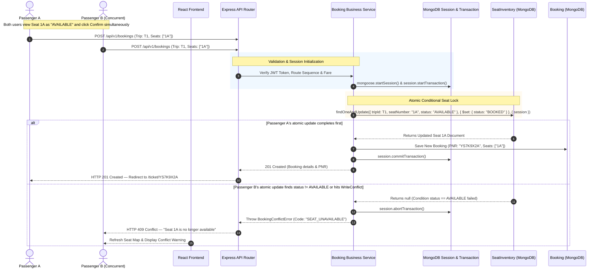

# Booking Sequence Diagram & Concurrency Resolution

This document illustrates the end-to-end transactional booking workflow in **YatraSetu**, highlighting the ACID isolation guarantees that prevent race conditions and double bookings.



---

## Technical Analysis of the ACID Concurrency Guarantee

1. **Conditional Predicate**:
   Updates are executed using a conditional filter:
   ```javascript
   SeatInventory.findOneAndUpdate(
     { tripId, seatNumber, status: 'AVAILABLE' },
     { $set: { status: 'BOOKED' } },
     { session, new: true }
   );
   ```
   If another transaction has committed or locked the record, the condition evaluates to `null`.

2. **Transaction Rollback on Partial Failures**:
   If a customer reserves multiple seats (e.g., `["2A", "2B", "2C"]`) and even one seat fails the availability condition, `session.abortTransaction()` is invoked immediately. No orphan or partial bookings are ever committed.

3. **Database Write Conflict Handling**:
   When simultaneous transactions attempt concurrent document modifications, MongoDB triggers a `WriteConflict` (`code: 112`, `TransientTransactionError`). The server catches this error specifically and maps it to HTTP `409 Conflict` (`SEAT_UNAVAILABLE`).

