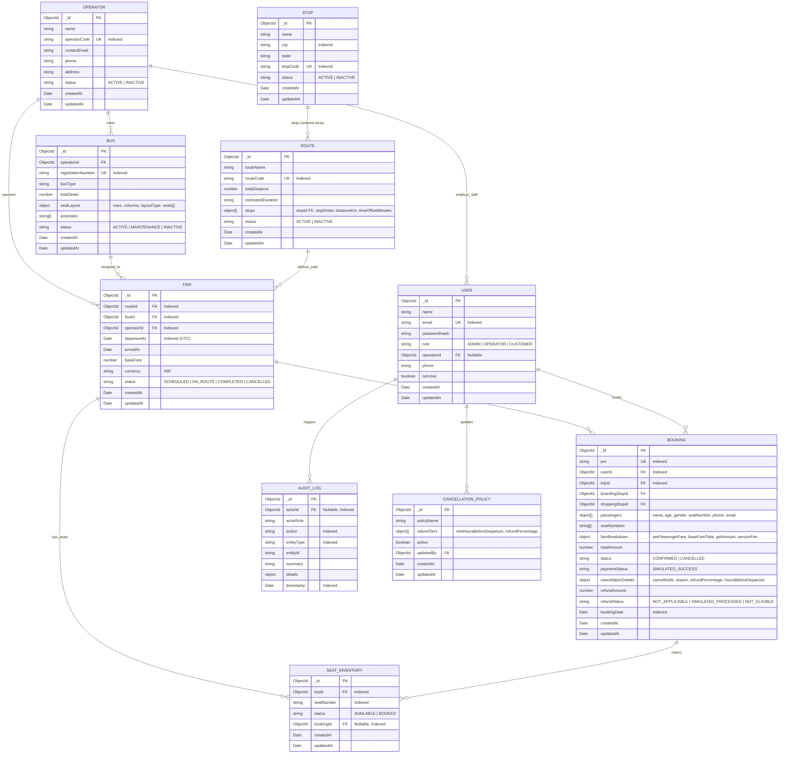

# Entity-Relationship (ER) Diagram — YatraSetu

## Architecture & Relational Topology in MongoDB Atlas

Below is the normalized relational schema implemented using **Mongoose ODM**. It enforces strict foreign-key referencing, compound uniqueness constraints, and transactional consistency.



---

## Critical Database Indexes & Integrity Rules

1. **Seat Inventory Compound Unique Index**:
   ```javascript
   seatInventorySchema.index({ tripId: 1, seatNumber: 1 }, { unique: true });
   ```
   *Guarantees at database-engine level that no trip can ever have duplicate seat allocation records.*

2. **PNR Unique Index**:
   ```javascript
   bookingSchema.index({ pnr: 1 }, { unique: true });
   ```
   *Enforces official PNR uniqueness.*

3. **User Email Unique Index**:
   ```javascript
   userSchema.index({ email: 1 }, { unique: true });
   ```

4. **Trip Composite Index**:
   ```javascript
   tripSchema.index({ routeId: 1, departureAt: 1, status: 1 });
   ```
   *Optimizes high-throughput travel date range queries and route segment lookups.*

